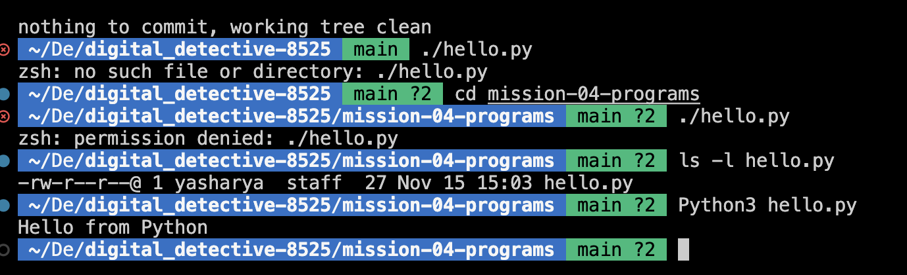

# Mission 4: How Programs run

## 1. Task / Objective
- To understand Python program execution and the difference between compilers and interpreters.

## 2. Work Completed
- Task 4.1: Created a `hello.py` file, wrote the given Python code and executed it using `python3` in the terminal.
- Task 4.2: Compared compilers and interpreters based on execution, output, examples and advantages.

## 3. Commands / Tools Used
- `python3 hello.py`
- VS Code
- Terminal

## 4. My Understanding
Learned how to create and execute a Python program through the terminal and understood the basic differences between compilers and interpreters.

## 5. Difficulties Faced
None

## 6. How I Resolved Them ?
Not applicable

## 7. Evidence / Files
- `hello.py`
- `README.md`
- `mission4.md`
- screenshot below:-
 

## 8. Commit Details
- commit message: "Compare compilers and interpretors"
- Changes Successfully pushed to Github.
